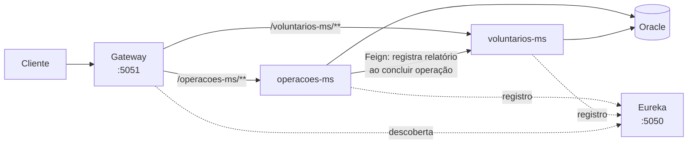
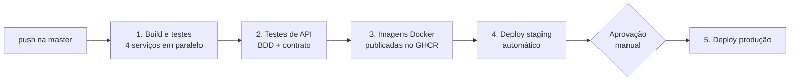
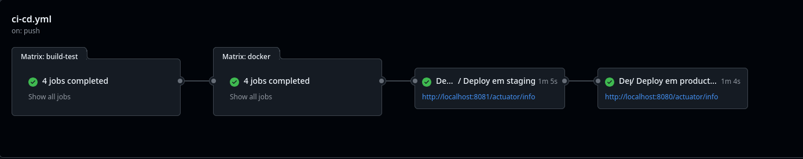
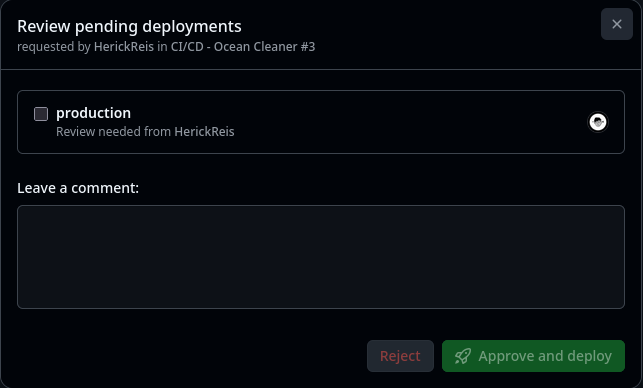
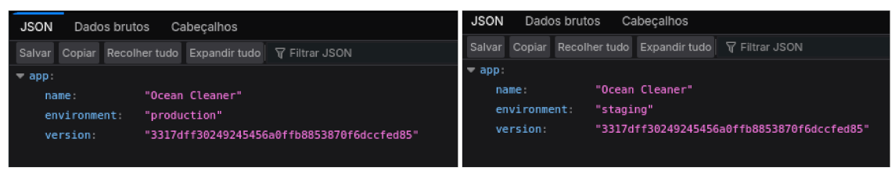
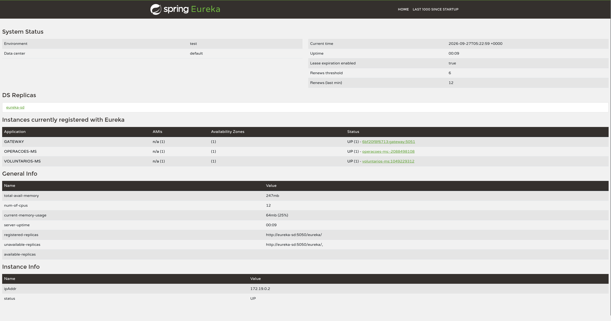
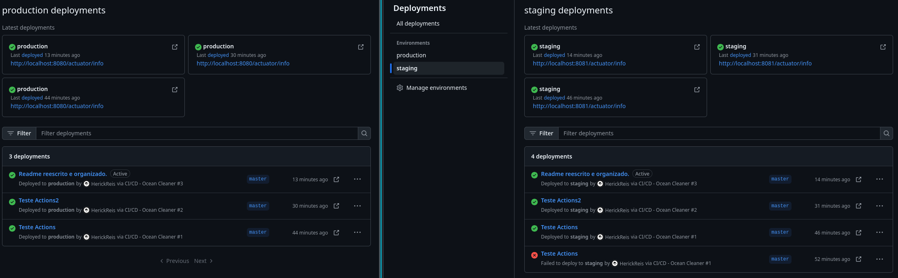

# Ocean Cleaner — Projeto ESG (Cidades ESG Inteligentes: eixo Environmental, ODS 14)

API em microsserviços para organizar **operações de limpeza de áreas marítimas**: cadastro de áreas poluídas, planejamento de operações, gestão de voluntários e registro dos resíduos coletados.

> Projeto Java Spring adaptado para DevOps. `Cidades ESG Inteligentes` é sugestão de tema; este repo implementa o recorte ambiental/oceânico.

Integrantes:
- Gabriel Borges Cedraz de Santana — ga.czsan@gmail.com
- Matheus de Oliveira Radeze — radezemat@outlook.com
- Sabrina Pires Gomes da Silva — sassadesabrina@gmail.com
- Herick Reis Nascimentos dos Santos — herickreis90.90@gmail.com

> 📘 **Documentação técnica para desenvolvedores** (classes, serviços, regras de negócio e como evoluir o projeto): [docs/DOCUMENTACAO.md](docs/DOCUMENTACAO.md)
> 🧪 **Testes automatizados de API** (BDD/Gherkin + JSON Schema, rodam no CI): [api-tests](api-tests/README.md)
> 📮 **Testes manuais de todos os endpoints** (Postman / Insomnia): [docs/postman](docs/postman/README.md)

O projeto conta com um pipeline de **CI/CD no GitHub Actions** que compila, testa, gera imagens Docker e faz o deploy automático em **staging** e, após aprovação manual, em **produção**.

---

## Sumário
- [Projeto - Cidades ESG Inteligentes](#projeto---cidades-esg-inteligentes)
- [Arquitetura](#arquitetura)
- [Tecnologias utilizadas](#tecnologias-utilizadas)
- [Como executar localmente com Docker](#como-executar-localmente-com-docker)
- [Endpoints da API](#endpoints-da-api)
- [Pipeline CI/CD](#pipeline-cicd)
- [Ambientes (staging e produção)](#ambientes-staging-e-produção)
- [Configurando o pipeline em um novo repositório](#configurando-o-pipeline-em-um-novo-repositório)
- [Testes](#testes)
- [Containerização](#containerização)
- [Prints do funcionamento](#prints-do-funcionamento)

---

## Projeto - Cidades ESG Inteligentes

Recorte ambiental: limpeza de áreas marítimas. Cobre `Environmental` via remoção de resíduos e `Social` via voluntariado. Governança via pipeline, logs e versionamento.

## Arquitetura



| Serviço | Função | Porta (local) |
|---|---|---|
| `eureka-sd` | Service discovery (Netflix Eureka) | 5050 |
| `gateway` | Ponto de entrada único; roteia por nome de serviço com load balancing | 5051 |
| `operacoes-ms` | Áreas marítimas e operações de limpeza | aleatória (via Eureka) |
| `voluntarios-ms` | Voluntários e relatórios de coleta | aleatória (via Eureka) |
| `oracle-db` | Banco Oracle 23 Free (container) | 1521 |

**Integração entre serviços:** quando uma operação é atualizada com status `CONCLUIDA`, o `operacoes-ms` chama o `voluntarios-ms` via **OpenFeign** para registrar automaticamente o relatório de coleta.

**Banco de dados:** cada microsserviço versiona suas próprias tabelas com **Flyway** (históricos separados).

---

## Tecnologias utilizadas

- Java 21 · Spring Boot 4 · Spring Cloud 2025.1 (Gateway, Eureka, OpenFeign)
- Spring Data JPA · Flyway · Oracle Database 23 Free
- Spring Security (HTTP Basic)
- JUnit 5 · Mockito
- Cucumber (BDD/Gherkin) · Rest Assured · JSON Schema (testes de API e de contrato)
- Docker · Docker Compose (build multi-stage, usuário sem root)
- GitHub Actions · GitHub Container Registry (GHCR) · self-hosted runner

---

## Como executar localmente com Docker

**Pré-requisitos:** Docker com Docker Compose.

```bash
cp .env.example .env      # preencha as senhas
docker compose up -d --build
```

O primeiro start leva alguns minutos (inicialização do Oracle). Depois:

- Gateway: http://localhost:5051
- Painel do Eureka: http://localhost:5050
- Ambiente em execução: http://localhost:5051/actuator/info

Para parar: `docker compose down` (acrescente `-v` para apagar também os dados do banco).

### Variáveis de ambiente (`.env`)

| Variável | Descrição |
|---|---|
| `ORACLE_PASSWORD` | Senha do administrador do Oracle |
| `DB_USERNAME` / `DB_PASSWORD` | Usuário da aplicação (criado automaticamente no banco) |
| `DB_URL` | JDBC do banco (padrão: container local `oracle-db`) |
| `API_USER` / `API_PASSWORD` | Credenciais HTTP Basic exigidas em POST/PUT/DELETE |

O `.env` está no `.gitignore` e nunca deve ser versionado.

---

## Endpoints da API

Todas as chamadas passam pelo Gateway, prefixadas pelo nome do serviço.
**GET é público**; **POST, PUT e DELETE exigem autenticação HTTP Basic** (`API_USER` / `API_PASSWORD`).

### operacoes-ms — `/operacoes-ms`

| Método | Rota | Descrição |
|---|---|---|
| POST | `/areas-maritimas` | Cadastra área marítima |
| GET | `/areas-maritimas` | Lista áreas |
| GET | `/areas-maritimas/{id}` | Busca área por id |
| DELETE | `/areas-maritimas/{id}` | Remove área |
| POST | `/operacoes` | Cadastra operação |
| GET | `/operacoes` | Lista operações |
| GET | `/operacoes/{id}` | Busca operação por id |
| GET | `/operacoes/status/{status}` | Lista operações por status |
| PUT | `/operacoes/{id}` | Atualiza operação (status `CONCLUIDA` gera relatório no voluntarios-ms) |
| DELETE | `/operacoes/{id}` | Remove operação |

### voluntarios-ms — `/voluntarios-ms`

| Método | Rota | Descrição |
|---|---|---|
| POST | `/voluntarios` | Cadastra voluntário |
| GET | `/voluntarios` | Lista voluntários |
| GET | `/voluntarios/{id}` | Busca voluntário por id |
| PUT | `/voluntarios/{id}` | Atualiza voluntário |
| DELETE | `/voluntarios/{id}` | Remove voluntário |
| POST | `/relatorios` | Cadastra relatório de coleta |
| GET | `/relatorios` | Lista relatórios |
| GET | `/relatorios/{id}` | Busca relatório por id |
| GET | `/relatorios/operacao/{idOperacao}` | Relatórios de uma operação |
| GET | `/relatorios/voluntario/{idVoluntario}` | Relatórios de um voluntário |
| DELETE | `/relatorios/{id}` | Remove relatório |

### Exemplo de fluxo completo

```bash
GW=http://localhost:5051
AUTH="admin:SUA_SENHA"

# 1. Área marítima
curl -u $AUTH -X POST $GW/operacoes-ms/areas-maritimas -H "Content-Type: application/json" \
  -d '{"nome":"Praia do Gonzaga","localizacao":"Santos - SP","nivelPoluicao":"ALTO"}'

# 2. Voluntário
curl -u $AUTH -X POST $GW/voluntarios-ms/voluntarios -H "Content-Type: application/json" \
  -d '{"nome":"Ana Souza","email":"ana@email.com","especialidade":"Mergulho"}'

# 3. Operação planejada
curl -u $AUTH -X POST $GW/operacoes-ms/operacoes -H "Content-Type: application/json" \
  -d '{"titulo":"Mutirão Gonzaga","dataOperacao":"2026-10-10","status":"PLANEJADA","idArea":1}'

# 4. Conclusão da operação -> gera o relatório no voluntarios-ms via Feign
curl -u $AUTH -X PUT $GW/operacoes-ms/operacoes/1 -H "Content-Type: application/json" \
  -d '{"titulo":"Mutirão Gonzaga","dataOperacao":"2026-10-10","status":"CONCLUIDA","idArea":1,
       "idVoluntario":1,"quantidadeResiduos":120,"tipoResiduo":"Plástico"}'

# 5. Relatório criado automaticamente
curl $GW/voluntarios-ms/relatorios/operacao/1
```

---

## Pipeline CI/CD

Arquivos: [`.github/workflows/ci-cd.yml`](.github/workflows/ci-cd.yml) e [`.github/workflows/deploy.yml`](.github/workflows/deploy.yml).



| Etapa | Onde roda | O que faz |
|---|---|---|
| **1. Build e testes** | Runner do GitHub (`ubuntu-latest`) | `mvn verify` em cada microsserviço (matrix). Publica relatórios de teste e resumo na execução. |
| **2. Testes de API** | Runner do GitHub | Sobe o ambiente completo com `docker compose` (senhas aleatórias) e executa os 45 cenários BDD de [`api-tests`](api-tests/README.md): status code, corpo JSON, contrato JSON Schema e comunicação entre serviços. Publica o relatório Cucumber (artifact `api-tests-report`) e um resumo na execução. |
| **3. Imagens Docker** | Runner do GitHub | Build multi-stage e push para o GHCR com as tags `<sha do commit>` e `latest`. Só roda se as etapas 1 e 2 passarem. |
| **4. Deploy staging** | Self-hosted runner | Gera o `.env` a partir dos secrets, baixa as imagens da versão e sobe o ambiente. Só conclui se o teste de fumaça passar. |
| **5. Deploy produção** | Self-hosted runner | Mesmo processo, **somente após aprovação** no environment `production`. |

Em **pull requests** rodam as etapas 1 e 2, garantindo que nada é mesclado sem compilar e passar nos testes.

**Teste de fumaça:** o [`deploy/deploy.sh`](deploy/deploy.sh) só considera o deploy bem-sucedido quando os dois microsserviços respondem `200` através do Gateway; caso contrário exibe os logs e falha o job.

**Rastreabilidade:** as imagens são identificadas pelo SHA do commit, e o endpoint `/actuator/info` de cada ambiente informa qual versão está no ar.

---

## Ambientes (staging e produção)

Os dois ambientes rodam na mesma máquina (self-hosted runner), isolados por **projetos Docker Compose diferentes**: cada um tem seus próprios containers, rede, volume de banco e credenciais.

| | Staging | Produção |
|---|---|---|
| Gateway | http://localhost:8081 | http://localhost:8080 |
| Eureka | http://localhost:8762 | http://localhost:8761 |
| Projeto Compose | `oceancleaner-staging` | `oceancleaner-production` |
| Deploy | automático a cada push na `master` | após aprovação manual |
| Credenciais | secrets do environment `staging` | secrets do environment `production` |

Diferenças para o ambiente local ([`deploy/docker-compose.deploy.yml`](deploy/docker-compose.deploy.yml)):
- as imagens **não são compiladas** na máquina: são baixadas do GHCR, exatamente as que passaram nos testes;
- `restart: unless-stopped` em todos os serviços;
- memória das JVMs limitada para os dois ambientes caberem na mesma máquina.

Para derrubar um ambiente manualmente:

```bash
cd ~/oceancleaner-deploy/staging
docker compose -p oceancleaner-staging -f docker-compose.deploy.yml down
```

---

## Configurando o pipeline em um novo repositório

1. **Self-hosted runner** — *Settings → Actions → Runners → New self-hosted runner* (Linux x64). Instale em um caminho **sem espaços** (ex.: `~/actions-runner`) e inicie com `./run.sh`. A máquina precisa de Docker e de ~10 GB livres em disco.
2. **Environments** — em *Settings → Environments*, crie:
   - `staging`
   - `production`, com **Required reviewers** marcado (obs: para que esta opção apareça, o repositório deve estar publico, ou privado com uma assinatura do GitHub Business)
3. **Secrets** — em cada environment, crie `ORACLE_PASSWORD`, `DB_PASSWORD` e `API_PASSWORD` (senhas diferentes por ambiente; use apenas letras e números).
4. Faça push na `master` e acompanhe na aba **Actions**.

> **Segurança:** com self-hosted runner em repositório público, ative *Settings → Actions → General → Require approval for all external contributors*, para que pull requests de terceiros não executem código na máquina do runner.

---

## Testes

O projeto tem duas camadas de testes automatizados, ambas executadas no pipeline:

### 1. Testes unitários e de integração (por microsserviço)

```bash
cd operacoes-ms && ./mvnw verify
```

| Serviço | Testes |
|---|---|
| `operacoes-ms` | `AreaMaritimaServiceTest`, `OperacaoServiceTest` (Feign, fail-fast, idempotência, delete), `ControllersMvcTest` (auth/validação), `OperacaoFluxoTest` (fluxo HTTP+JPA+Feign), contexto H2 |
| `voluntarios-ms` | `VoluntarioServiceTest`, `RelatorioColetaServiceTest`, `ControllersMvcTest` (auth/validação), contexto H2 |
| `gateway`, `eureka-sd` | Teste de contexto |

Os testes unitários usam Mockito e não dependem de banco nem de outros serviços. Nos microsserviços, os testes de contexto usam um banco H2 em memória (`src/test/resources/application-test.properties`) no lugar do Oracle. O pipeline gera relatório JaCoCo por serviço (falha abaixo de 30%) e bloqueia o deploy em vulnerabilidades `HIGH,CRITICAL` (Trivy).

### 2. Testes de API — BDD + contrato ([`api-tests/`](api-tests/README.md))

Cenários em **Gherkin** (português) executados com **Cucumber + Rest Assured** contra o Gateway, com o ambiente completo no ar. Cobrem **todos os endpoints** dos dois microsserviços, além do Gateway e do Eureka, validando:

- **status code** de cada resposta, em cenários positivos e negativos (400, 401, 404, 409, 502);
- **corpo JSON** (valores retornados);
- **contrato** com **JSON Schema** para cada tipo de resposta (entidades, listas e erros);
- **comunicação entre serviços**: concluir uma operação no `operacoes-ms` cria o relatório no `voluntarios-ms` via Feign, e uma falha nessa chamada vira `502`.

```bash
cp .env.example .env                  # preencha as senhas
./api-tests/executar.sh --subir       # sobe o docker compose e roda os 45 cenários
```

Relatório em `api-tests/target/cucumber-report.html`. Detalhes, tags e variáveis em [api-tests/README.md](api-tests/README.md).

Exemplo de cenário ([04_operacoes.feature](api-tests/src/test/resources/features/04_operacoes.feature)):

```gherkin
Cenário: Rejeitar conclusão sem os dados da coleta
  Dado que existe uma operação "EM_ANDAMENTO" cadastrada nessa área
  Quando envio um PUT para "/operacoes-ms/operacoes/{operacaoId}" com o corpo:
    """
    {"titulo": "Mutirão {unico}", "dataOperacao": "2026-12-10", "status": "CONCLUIDA", "idArea": {areaId}}
    """
  Então o status da resposta deve ser 409
  E a resposta deve respeitar o contrato "erro.json"
  E a resposta deve conter:
    | erro | Conclusão exige idVoluntario, quantidadeResiduos e tipoResiduo |
```

---

## Containerização

`Dockerfile` por serviço (`eureka-sd/`, `gateway/`, `operacoes-ms/`, `voluntarios-ms/`): multi-stage `maven:3.9-eclipse-temurin-21-alpine` -> `eclipse-temurin:21-jre-alpine`, cache `pom.xml`, `USER spring` sem root. Orquestra via `docker-compose.yaml` local e `deploy/docker-compose.deploy.yml` staging/prod com volumes `oracle-data`, `oracle-backup`, rede `oceancleaner-network`, env `.env`, healthcheck + `depends_on: service_healthy`.

| Req banca | Neste repo |
|---|---|
| `Dockerfile` | 4x `*/Dockerfile` |
| `docker-compose.yml` | `docker-compose.yaml` + `deploy/docker-compose.deploy.yml` |
| `src/` | 4x `*/src` |
| `.github/workflows/` | `ci-cd.yml`, `deploy.yml` |
| `.env.example` | raiz |

---

## Prints do funcionamento

<!-- Adicione os prints na pasta docs/prints/ com estes nomes -->

**Execução completa do pipeline**


**Aprovação manual para produção**



**Ambientes no ar (`/actuator/info`)**


**Serviços registrados no Eureka**


**Histórico de deploys por ambiente**


---

## Checklist de entrega

- [x] Projeto compactado em .ZIP com estrutura organizada
- [x] Dockerfile funcional
- [x] docker-compose.yml ou arquivos Kubernetes (Compose escolhido)
- [x] Pipeline com etapas de build, teste e deploy
- [x] Cenários BDD em Gherkin (positivos e negativos)
- [x] Testes de API de todos os endpoints (status code, corpo JSON, contrato JSON Schema) executados no CI
- [x] README.md com instruções e prints
- [ ] Documentação técnica com evidências (PDF em `docs/ENTREGA.pdf`, gerar via pandoc)
- [ ] Deploy realizado nos ambientes staging e produção (exige runner self-hosted)
